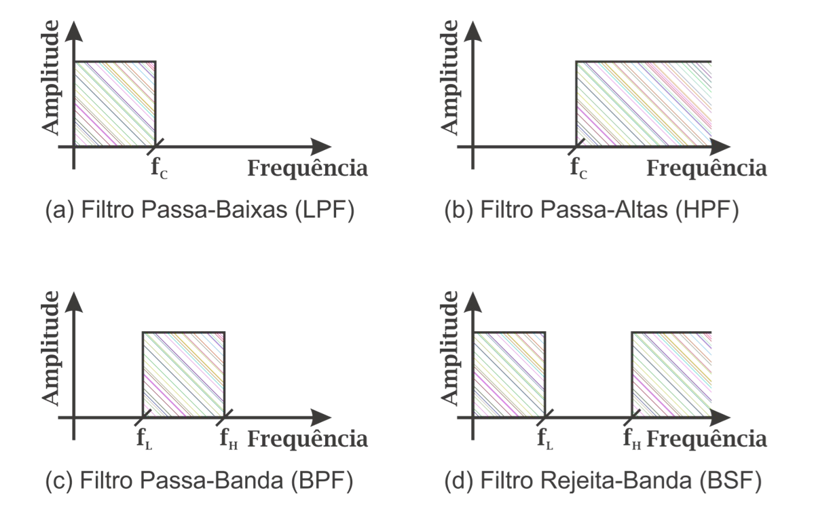
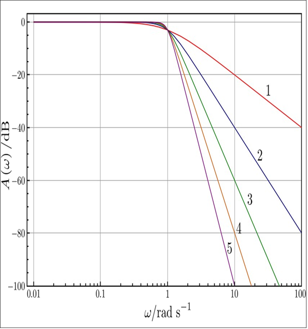
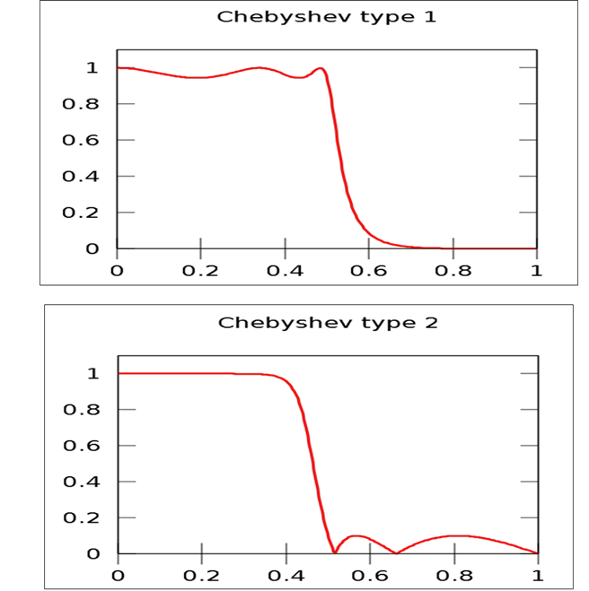
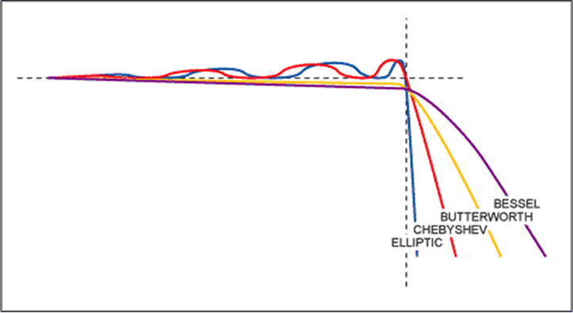
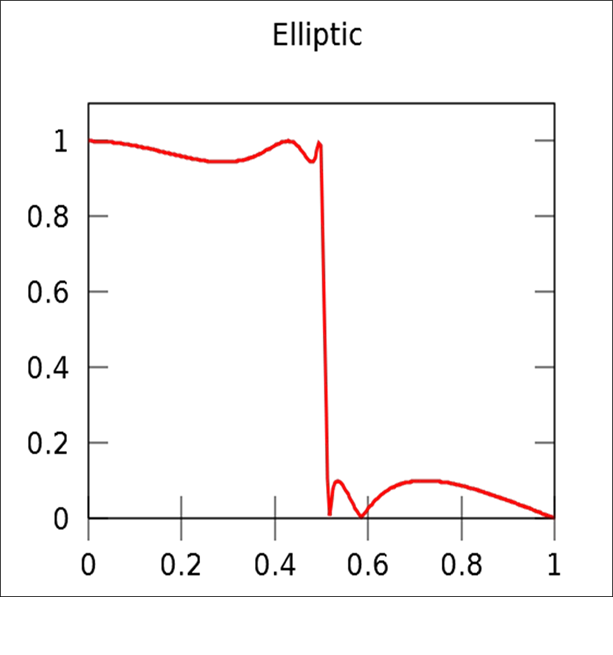

# II1P08 – Processamento Digital de Sinais com ESP32

Material da disciplina II1P08 (EININDI): filtragem digital e análise espectral no ESP32
com a biblioteca **esp-dsp**, e scripts em Python para projetar (sintonizar) os filtros.

## Sumário

1. [Estrutura do repositório](#1-estrutura-do-repositório)
2. [Preparando o ambiente](#2-preparando-o-ambiente)
3. [Exemplo `main0.cpp`: filtro passa-faixa + FFT](#3-exemplo-main0cpp-filtro-passa-faixa--fft)
4. [Sintonizando o filtro com Python](#4-sintonizando-o-filtro-com-python)
5. [Teoria: filtros analógicos](#5-teoria-filtros-analógicos)

---

## 1. Estrutura do repositório

| Caminho | Conteúdo |
|---|---|
| [`src/main0.cpp`](src/main0.cpp) | **Exemplo desta aula:** sinal de teste → filtro passa-faixa → FFT → gráficos |
| [`src/main1.cpp`](src/main1.cpp), [`src/main2.cpp`](src/main2.cpp) | Passa-baixa em tempo real (sinal sintético / leitura do ADC no GPIO34) |
| [`include/services/wserial.h`](include/services/wserial.h) | Envio de gráficos pela serial (formato LasecPlot/Teleplot) |
| [`python/findDigitalFilterIIRBiquadsByTargetFreq.py`](python/findDigitalFilterIIRBiquadsByTargetFreq.py) | Projeta filtros **digitais** IIR e imprime os coeficientes prontos para o C |
| [`python/findAnalogFilterByTargetFreq.py`](python/findAnalogFilterByTargetFreq.py) | Projeta filtros **analógicos** (ex.: anti-aliasing antes do ADC) |
| [`python/README.md`](python/README.md) | A matemática completa dos dois scripts |
| [`LasecSimul/`](LasecSimul/) | Circuitos para o simulador |
| [`platformio.ini`](platformio.ini) | Configuração do PlatformIO, incluindo **qual** `mainX.cpp` é compilado |

---

## 2. Preparando o ambiente

**Firmware (ESP32)**

1. Instale o VS Code e a extensão **PlatformIO IDE**.
2. Abra a pasta do projeto. O PlatformIO baixa sozinho a plataforma ESP32 e as bibliotecas
   (a esp-dsp já vem junto com o framework Arduino-ESP32).

**Python**

1. No VS Code: `Ctrl+Shift+P` → **Python: Select Interpreter** → escolha o Python instalado.
2. Instale as bibliotecas **nesse mesmo Python** (terminal do VS Code):

   ```
   python -m pip install numpy scipy matplotlib
   ```

   ou execute [`python/00_instalLibPython.bat`](python/00_instalLibPython.bat), que instala
   também as bibliotecas usadas nos notebooks.

---

## 3. Exemplo `main0.cpp`: filtro passa-faixa + FFT

### 3.1 O que o programa faz

```
 x[n] = sen(100 Hz) + sen(800 Hz) + sen(2200 Hz)      fs = 8 kHz, N = 1024 amostras
   │
   ├──────────────────────────────────────────────► FFT ──► X_dB  (espectro de x)
   │
   └──► passa-faixa 700–900 Hz (2 biquads) ──► y[n] ──► FFT ──► Y_dB  (espectro de y)
```

O filtro deixa passar o tom de 800 Hz e atenua os de 100 Hz e 2200 Hz. Tudo é calculado
**uma única vez** no `setup()`. O `loop()` só mantém a serial funcionando.

### 3.2 Compilar, gravar e ver os gráficos

1. Em [`platformio.ini`](platformio.ini), escolha o exemplo:

   ```ini
   build_src_filter = +<main0.cpp>
   ```

2. Na barra do PlatformIO, clique em **Upload** (→).
3. Abra o **LasecPlot** (ou o Teleplot) na porta COM da placa, a **921600 baud**
   (o mesmo `monitor_speed` do `platformio.ini`).
4. Aperte **EN/RESET** na placa: os gráficos são enviados só uma vez, logo após o boot.

### 3.3 O que esperar nos gráficos

| Gráfico | Eixo horizontal | O que observar |
|---|---|---|
| `x` | amostra `n` (cada ponto = 1/fs = 0,125 ms) | soma dos 3 senos |
| `y` | amostra `n` | praticamente só o seno de 800 Hz. Nos primeiros ~3 ms (~22 amostras) a amplitude cresce a partir de zero: é o **transitório** do filtro, que começa com memória zerada |
| `X_dB` | raia `k` | 3 picos de ≈ −12 a −13 dB |
| `Y_dB` | raia `k` | o pico de 800 Hz continua em ≈ −13 dB; o de 100 Hz cai para ≈ −62 dB e o de 2200 Hz para ≈ −47 dB |

Para converter a raia `k` em frequência: **f = k · fs / N = k × 7,8125 Hz**.

| Tom | Raia (k = f · N / fs) |
|---|---|
| 100 Hz | 12,8 |
| 800 Hz | 102,4 |
| 2200 Hz | 281,6 |

> **Por que o pico fica em ≈ −12 dB e não em 0 dB?** Um seno de amplitude 1 divide sua
> energia entre +f e −f (fator ½), e a janela de Hann tem ganho médio 0,5 (outro fator ½):
> 1 × ½ × ½ = 0,25 → 20·log10(0,25) ≈ −12 dB. Como os tons não caem exatamente em cima
> de uma raia (12,8; 102,4; 281,6), o pico ainda perde até ~1,4 dB.

### 3.4 O código, bloco a bloco

**Bibliotecas**

| `#include` | Para quê |
|---|---|
| `services/wserial.h` | `wserial.plot(...)`: envia vetores para o LasecPlot/Teleplot |
| `dsps_tone_gen.h` | `dsps_tone_gen_f32`: gera um seno (tom) |
| `dsps_add.h` | `dsps_add_f32`: soma dois vetores, elemento a elemento |
| `dsps_biquad.h` | `dsps_biquad_f32`: filtro IIR de 2ª ordem (biquad) |
| `dsps_fft2r.h` | `dsps_fft2r_fc32`: FFT radix-2 |
| `dsps_wind_hann.h` | `dsps_wind_hann_f32`: janela de Hann |

**Parâmetros do sinal**

```cpp
constexpr int   N  = 1024;     // numero de amostras (a FFT exige potencia de 2)
constexpr float fs = 8000.0f;  // frequencia de amostragem [Hz]
```

- `N` precisa ser potência de 2 porque a FFT radix-2 divide o vetor ao meio sucessivas vezes.
- Resolução em frequência: `fs/N` = 7,8 Hz por raia. Duração do sinal: `N/fs` = 128 ms.
- Nyquist: a maior frequência representável é `fs/2` = 4000 Hz. Os três tons estão abaixo disso.

**Coeficientes do filtro**

```cpp
float biquads_df2t[2][5] = {
    { b0, b1, b2, a1, a2 },   // biquad 1
    { b0, b1, b2, a1, a2 },   // biquad 2
};
constexpr int NUM_BIQUADS = sizeof(biquads_df2t) / sizeof(biquads_df2t[0]);
```

- Cada linha é um **biquad**, um filtro IIR de 2ª ordem que calcula a equação de diferenças

  y[n] = b0·x[n] + b1·x[n−1] + b2·x[n−2] − a1·y[n−1] − a2·y[n−2]

  ou seja, H(z) = (b0 + b1·z⁻¹ + b2·z⁻²) / (1 + a1·z⁻¹ + a2·z⁻²). O `a0` vale sempre 1
  e por isso não é guardado.
- Um filtro de ordem alta é implementado como **vários biquads em cascata**, porque isso é
  numericamente bem mais estável em `float` do que um único polinômio de ordem alta.
- `NUM_BIQUADS` divide o tamanho do array pelo tamanho de uma linha, ou seja, conta as
  linhas sozinho. Se você colar um array com 4 biquads, nada mais precisa mudar no código.
- Os números vêm do script Python (seção 4). O array não é `const` porque
  `dsps_biquad_f32` recebe `float *`.

**Vetores**: `x` (original), `y` (filtrado), `janela` (Hann), `X_dB` e `Y_dB` (espectros,
com `N/2` raias cada).

**`gerarSinal`**

```cpp
dsps_tone_gen_f32(sinal, N, 1.0f, f1 / fs, 0);  // sinal = tom de f1
dsps_tone_gen_f32(tom, N, 1.0f, f2 / fs, 0);    // tom   = tom de f2
dsps_add_f32(sinal, tom, sinal, N, 1, 1, 1);    // sinal = sinal + tom
```

- `dsps_tone_gen_f32(saida, N, amplitude, frequência, fase)` preenche o vetor com
  `amplitude · sen(2π·freq·n + fase)`, com a fase em graus.
- **A frequência é normalizada por `fs`** (`f/fs`, entre 0 e 0,5). A documentação da
  esp-dsp fala em "Nyquist −1..1", o que sugere `f/(fs/2)`, mas com essa conta todos os
  tons saem com o dobro da frequência (800 Hz vira 1600 Hz).
- `dsps_add_f32(a, b, saida, N, 1, 1, 1)` faz `saida[i] = a[i] + b[i]`. Os três `1` são os
  passos (*step*) de leitura e escrita: 1 = usar todos os elementos, em sequência.
- O vetor `tom` é reaproveitado: gera um tom, soma ao sinal, gera o próximo e soma de novo.

**`filtrar`**

```cpp
memcpy(saida, entrada, N * sizeof(float));
for (int k = 0; k < NUM_BIQUADS; k++) {
    float w[2] = {0, 0};
    dsps_biquad_f32(saida, saida, N, biquads_df2t[k], w);
}
```

- Copia a entrada para a saída e passa o vetor por cada biquad, um depois do outro (cascata).
  A saída do biquad 1 é a entrada do biquad 2, e assim por diante.
- `w[2]` é a **memória** do biquad: os dois valores atrasados (z⁻¹ e z⁻²) da forma direta II.
  Começar com zero equivale a supor que o sinal era zero antes de `n = 0`, e é isso que
  causa o transitório visto no início de `y`.
- Entrada e saída podem ser o mesmo vetor, porque cada amostra é lida antes de ser sobrescrita.

**`calcularEspectroDb`**

1. **Janela de Hann**: os 1024 pontos não contêm um número inteiro de períodos dos senos, e
   o "corte" nas bordas espalha energia por todo o espectro (vazamento espectral). A janela
   suaviza as bordas e reduz esse vazamento.
2. **Vetor complexo intercalado** `[re0, im0, re1, im1, ...]`: a FFT da esp-dsp trabalha com
   números complexos. Como o sinal é real, a parte imaginária é zero.
3. `dsps_fft2r_fc32` calcula a FFT no próprio vetor, mas devolve as raias em **ordem de bits
   invertidos** (efeito do algoritmo radix-2). `dsps_bit_rev_fc32` coloca na ordem 0, 1, 2, …
4. Só as raias de `0` a `N/2 − 1` (0 a fs/2) são usadas: o espectro de um sinal real é
   espelhado, e a outra metade repete a mesma informação.
5. Módulo `|X[k]| = √(re² + im²)`, dividido por `N` para normalizar, convertido para dB com
   `20·log10`. O `+1e-6` evita `log10(0)` (o "piso" fica em −120 dB).

**`setup` e `loop`**

- `dsps_fft2r_init_fc32(NULL, N)` precisa ser chamado uma vez antes de qualquer FFT: ele
  calcula a tabela de senos e cossenos (*twiddle factors*) usada pelo algoritmo.
- A janela de Hann é calculada uma única vez e reaproveitada nas duas FFTs.
- `wserial.plot(nome, 1, vetor, tamanho, unidade)` envia o vetor inteiro. O `1` é o passo
  do eixo horizontal, que fica 0, 1, 2, … (amostra `n` ou raia `k`).

---

## 4. Sintonizando o filtro com Python

### 4.1 A ideia

O projeto clássico pede "a frequência de corte de −3 dB". O script
[`findDigitalFilterIIRBiquadsByTargetFreq.py`](python/findDigitalFilterIIRBiquadsByTargetFreq.py)
responde a uma pergunta mais prática: **em qual frequência eu quero qual magnitude?**

- `fDesejada`: a frequência (ou a banda `[f1, f2]`) onde você sabe o que quer.
- `desvio`: a tolerância. Com `desvio = 0.05`, a banda de passagem tem ganho ≥ 0,95 e a
  banda de rejeição tem ganho ≤ 0,05 (−26 dB).
- `isBP`: `True` se `fDesejada` está na banda de passagem.

Com isso o script calcula o filtro **Butterworth** cuja curva passa exatamente por esse
ponto (já compensando a distorção de frequência da transformada bilinear) e o divide em
biquads com o `scipy`. A matemática completa está em [`python/README.md`](python/README.md).

No `main0.cpp`: `fDesejada = [700, 900]` com `isBP = True` garante ganho ≥ 0,95 entre 700 e
900 Hz. O tom de 800 Hz passa e os de 100 Hz e 2200 Hz são atenuados.

### 4.2 Passo a passo

1. Abra [`python/findDigitalFilterIIRBiquadsByTargetFreq.py`](python/findDigitalFilterIIRBiquadsByTargetFreq.py)
   e vá até o bloco `if __name__ == '__main__':`, no final do arquivo. Ele já está com os
   valores usados no `main0.cpp`:

   ```python
   sos, fc, f_comp = findDigitalFilterIIRBiquadsByTargetFreq(
       fDesejada=[700, 900],
       ordem=2,
       fs=8000.0,
       filterType="bandpass",
       desvio=0.05,
       isBP=True,
       plot=True,
   )
   ```

2. Altere os parâmetros que quiser (tabela da seção 4.3).
3. Rode o script com o botão **▶ Run Python File** do VS Code, ou no terminal, a partir da
   raiz do projeto:

   ```
   python python/findDigitalFilterIIRBiquadsByTargetFreq.py
   ```

4. Leia o resumo no terminal:

   ```
   Resultado do filtro IIR em biquads:
     Tipo: bandpass
     Ordem: 2
     Frequencia(s) desejada(s): [700, 900] Hz
     Frequencia(s) de corte: (637.15..., 984.55...)
     Frequencia(s) complementar(es): (326.75..., 1728.11...)
     Magnitude alvo/obtida: 0.950000000 / 0.950000000
   ```

   - **corte**: onde o ganho vale 0,707 (−3 dB).
   - **complementar**: onde o ganho cai para `desvio` (0,05). A partir dali começa a banda
     de rejeição.
   - **Magnitude alvo/obtida** iguais: o projeto atingiu o objetivo.

5. Confira o gráfico que abre: curva azul = |H(f)|, linhas amarelas = `fDesejada`, verdes =
   corte, roxas = complementar, ponto vermelho = magnitude alvo.
   **Feche a janela do gráfico**: só então o script imprime os coeficientes.
6. Copie o bloco impresso no terminal:

   ```c
   float biquads_df2t[2][5] = {
       {1.553585316e-02f, 3.107170631e-02f, 1.553585316e-02f, -1.345224238e+00f, 8.032745419e-01f},
       {1.000000000e+00f, -2.000000000e+00f, 1.000000000e+00f, -1.590652875e+00f, 8.464108338e-01f},
   };
   ```

7. No [`src/main0.cpp`](src/main0.cpp), substitua o array `biquads_df2t` por esse bloco e
   atualize o comentário `// Python: ...` logo acima com os parâmetros usados.
   `NUM_BIQUADS` se ajusta sozinho.
8. Se você mudou `fs` no Python, mude também `fs` no `main0.cpp`. Compile, grave e compare
   `X_dB` com `Y_dB`.

### 4.3 Parâmetros

| Parâmetro | Exemplo | Significado |
|---|---|---|
| `fDesejada` | `[700, 900]` ou `150` | Hz. **Lista** `[f1, f2]` para `bandpass`/`bandstop`, **número** para `lowpass`/`highpass` |
| `ordem` | `2` | Par e ≥ 2. Maior ordem = transição mais abrupta, mais biquads, transitório mais longo |
| `fs` | `8000.0` | Frequência de amostragem do firmware, em Hz |
| `filterType` | `"bandpass"` | `"lowpass"`, `"highpass"`, `"bandpass"` ou `"bandstop"` |
| `desvio` | `0.05` | Ganho em `fDesejada`: `1 − desvio` se `isBP=True`, ou `desvio` se `isBP=False` |
| `isBP` | `True` | `True`: `fDesejada` está na banda de passagem. `False`: está na banda de rejeição |
| `plot` | `True` | Mostra o gráfico da resposta em frequência |

**Quantos biquads saem:** `lowpass`/`highpass` → `ordem / 2`; `bandpass`/`bandstop` →
`ordem` (a transformação para banda dobra a ordem).

### 4.4 Cuidados

- **Use o mesmo `fs` nos dois lados.** Os coeficientes de um filtro digital só valem para a
  frequência de amostragem com que foram projetados. Se o mesmo array for usado com outro
  `fs`, todas as frequências do filtro mudam na mesma proporção.
- Todas as frequências precisam estar entre 0 e `fs/2` (Nyquist).
- Copie o array inteiro, incluindo a declaração `float biquads_df2t[...][5] = {`. Assim o
  tamanho declarado sempre bate com o número de linhas.

### 4.5 Exercícios sugeridos

Todos usam `fs = 8000.0` e `desvio = 0.05`, e foram conferidos com o script:

| Objetivo | Parâmetros | Biquads | Atenuação esperada (\|H\| em dB) |
|---|---|---|---|
| Rejeitar mais | `fDesejada=[700, 900]`, `ordem=4`, `"bandpass"`, `isBP=True` | 4 | 100 Hz: −108 · 800 Hz: 0 · 2200 Hz: −78 |
| Ficar só com 100 Hz | `fDesejada=150`, `ordem=4`, `"lowpass"`, `isBP=True` | 2 | 100 Hz: 0 · 800 Hz: −50 · 2200 Hz: −94 |
| Ficar só com 2200 Hz | `fDesejada=2000`, `ordem=4`, `"highpass"`, `isBP=True` | 2 | 100 Hz: −103 · 800 Hz: −29 · 2200 Hz: 0 |
| Remover só 800 Hz | `fDesejada=[750, 850]`, `ordem=2`, `"bandstop"`, `isBP=False` | 2 | 100 Hz: 0 · 800 Hz: −89 · 2200 Hz: 0 |

Perguntas para discutir: por que o passa-alta atenua tão pouco o tom de 800 Hz, e o que
muda ao aumentar a ordem? O que acontece com o transitório de `y` quando a ordem aumenta?

### 4.6 E o script analógico?

[`findAnalogFilterByTargetFreq.py`](python/findAnalogFilterByTargetFreq.py) usa o mesmo
critério (`fDesejada`, `desvio`, `isBP`) para um Butterworth **analógico** (não tem `fs`).
Ele devolve a(s) frequência(s) de corte em Hz para dimensionar resistores e capacitores, por
exemplo do filtro anti-aliasing que fica antes do ADC.

---

## 5. Teoria: filtros analógicos

### Introdução

Filtros analógicos são circuitos eletrônicos que processam sinais contínuos para atenuar ou destacar componentes específicos de frequência. Utilizados em áreas como telecomunicações, áudio e instrumentação, eles são implementados com componentes passivos (resistores, capacitores, indutores) ou ativos (amplificadores operacionais). Este documento detalha sua classificação, funcionamento, metodologias de projeto (incluindo Butterworth, Chebyshev, Bessel e Elíptico) e aplicações práticas.

---

### Classificação dos Filtros Analógicos

#### 1. Por Tecnologia

*   **Filtros Passivos**:  
    Compostos por resistores, capacitores e indutores. Não requerem fonte de energia externa e são ideais para aplicações de baixa frequência e alta potência.
    Exemplo: Filtro RC passa-baixa.
*   **Filtros Ativos**:  
    Incluem amplificadores operacionais ou transistores, permitindo maior controle do ganho, impedância e resposta em frequências mais altas. Requerem alimentação externa.
    Exemplo: Filtro Sallen-Key.

#### 2. Por Resposta em Frequência

| Tipo                  | Função                                                                                           | Aplicações Típicas                                                         |
| :-------------------- | :----------------------------------------------------------------------------------------------- | :------------------------------------------------------------------------- |
| **Passa-Baixa (LPF)** | Permite frequências abaixo da frequência de corte ($f_c$).                                    | Redução de ruído em sistemas de áudio, suavização de sinais.               |
| **Passa-Alta (HPF)**  | Permite frequências acima de $f_c$.                                                           | Eliminação de *DC offset*, acoplamento AC.                               |
| **Passa-Banda (BPF)** | Permite uma faixa específica entre duas frequências de corte ($f_{c1}$ e $f_{c2}$).         | Rádio FM, equalizadores paramétricos.                                     |
| **Rejeita-Banda (BEF)** | Bloqueia uma faixa específica de frequências. Também conhecido como *notch filter*.             | Eliminação de interferência (ex: 60Hz da rede elétrica).                 |
| **Passa-Tudo (APF)**  | Mantém a amplitude do sinal, mas altera sua fase. Usado para correção de fase ou atraso de sinal. | Correção de fase em sistemas de comunicação, emula atrasos em processamento. |


---

### Princípio de Funcionamento

Filtros analógicos operam modificando a relação entre tensão e corrente em função da frequência:

*   **Filtros Passivos**: Usam combinações de impedâncias (ex.: $$Z = R + \frac{1}{j\omega C}$$) para criar atenuação seletiva. A energia é dissipada (em resistores) ou armazenada (em capacitores e indutores).
*   **Filtros Ativos**: Combinam componentes passivos com amplificadores para ajustar ganho e impedância. Permitem maior flexibilidade no projeto, incluindo ganho de sinal e impedâncias de entrada/saída controladas.

A função de transferência $$H(s)$$ de um filtro é crítica para definir seu comportamento.

---

### Projeto de Filtros Analógicos

#### Tipos de Resposta

##### Butterworth

*   **Características**:
    *   Banda passante plana (sem ondulações/ripple).
    *   Atenuação gradual: -6n dB/oitava (n = ordem do filtro).
    *   Boa resposta de fase, com menor distorção de sinal.
*   **Função de Transferência** (2ª ordem):
    $$
    H(s) = \frac{\omega_c^2}{s^2 + \sqrt{2}\omega_c s + \omega_c^2}
    $$
*   **Aplicações**: Sistemas de áudio de alta fidelidade, instrumentação, onde a precisão na banda passante é fundamental. 

##### Chebyshev

*   **Características**:
    *   Ondulações (ripple) controladas na banda passante (Tipo I) ou banda de rejeição (Tipo II).
    *   Transição abrupta entre bandas (maior seletividade).
    *   Maior distorção de fase em comparação com Butterworth.
*   **Função de Transferência** (Tipo I):
    $$
    |H(\omega)|^2 = \frac{1}{1 + \epsilon^2 T_n^2(\omega/\omega_c)}
    $$
    onde $$T_n$$ é o polinômio de Chebyshev e $$\epsilon$$ define a amplitude do ripple.
*   **Aplicações**: Telecomunicações, processamento de sinais, onde a seletividade é mais importante que a fidelidade na banda passante. 

##### Bessel

*   **Características**:
    *   Resposta de fase linear na banda passante, ideal para preservar a forma de onda dos sinais (mínima distorção de fase).
    *   Atenuação mais gradual do que Butterworth ou Chebyshev.
    *   Retardo de grupo constante na banda passante.
*   **Função de Transferência**: Os polos são dispostos de forma a maximizar a linearidade da fase. Não há uma forma simples para a função de transferência geral.
*   **Aplicações**: Sistemas de comunicação de dados, processamento de vídeo, onde a integridade do sinal no domínio do tempo é crucial. 

##### Elíptico (Cauer)

*   **Características**:
    *   Ondulações tanto na banda passante quanto na banda de rejeição.
    *   Transição mais rápida (maior seletividade) entre a banda passante e a banda de rejeição em comparação com os outros tipos.
    *   Maior complexidade de projeto e implementação.
*   **Função de Transferência**: Envolve funções elípticas de Jacobi.
*   **Aplicações**: Aplicações que exigem a maior seletividade possível, como sistemas de análise espectral de alta precisão e processamento de sinais de rádio. 

#### Comparação de Respostas em Frequência

\[Imagem ou gráfico comparando as respostas de frequência dos filtros Butterworth, Chebyshev, Bessel e Elíptico, mostrando as diferenças em ripple, seletividade e resposta de fase]

#### Etapas de Projeto

1.  **Definição de Requisitos**:
    *   Especificar as frequências de corte, atenuação na banda de rejeição, ripple máximo (se aplicável) e tipo de resposta desejada (Butterworth, Chebyshev, Bessel, Elíptico).
2.  **Seleção da Topologia**:
    *   Filtros Passivos: Selecionar entre topologias LC (para alta qualidade e baixa perda) ou RC (para aplicações de baixa frequência).
    *   Filtros Ativos: Escolher entre topologias como Sallen-Key (para filtros de 2ª ordem), Multiple Feedback (MFB) ou outras configurações baseadas em amplificadores operacionais.
3.  **Cálculo dos Componentes**:
    *   Utilizar tabelas de filtros normalizados, software de projeto de filtros ou cálculos manuais para determinar os valores dos componentes (resistores, capacitores, indutores) com base nas especificações do filtro.
4.  **Simulação e Otimização**:
    *   Simular o circuito do filtro em software como SPICE ou LTspice para verificar se a resposta em frequência atende aos requisitos. Otimizar os valores dos componentes, se necessário, para melhorar o desempenho do filtro.
5.  **Implementação e Teste**:
    *   Construir o circuito do filtro em uma placa de circuito impresso (PCB) ou protoboard. Testar o filtro com equipamentos de teste, como analisadores de espectro ou geradores de sinais, para verificar se ele atende às especificações.

---

### Aplicações

1.  **Telecomunicações**:
    *   Filtros Chebyshev ou Elípticos em transmissores e receptores de RF para selecionar canais e rejeitar interferências.
    *   Filtros Bessel para preservar a integridade dos sinais de dados em sistemas de comunicação digital.
2.  **Áudio**:
    *   Filtros Butterworth em equalizadores gráficos e crossovers de áudio para suavizar a resposta em frequência e evitar distorções de fase.
    *   Filtros passa-baixa para eliminar ruídos de alta frequência em sistemas de gravação.
3.  **Instrumentação Médica**:
    *   Filtros para remover ruídos e artefatos de sinais de ECG e EEG.
    *   Filtros passa-alta para remover o *DC offset* e a derivação da linha de base em sinais biomédicos.
4.  **Controle e Automação**:
    *   Filtros para suavizar sinais de sensores e atuadores em sistemas de controle.
    *   Filtros para eliminar ruídos em sistemas de aquisição de dados.

---

### Referências

*   \[Links para recursos adicionais sobre projeto de filtros analógicos, como livros, artigos técnicos, notas de aplicação e software de simulação.]